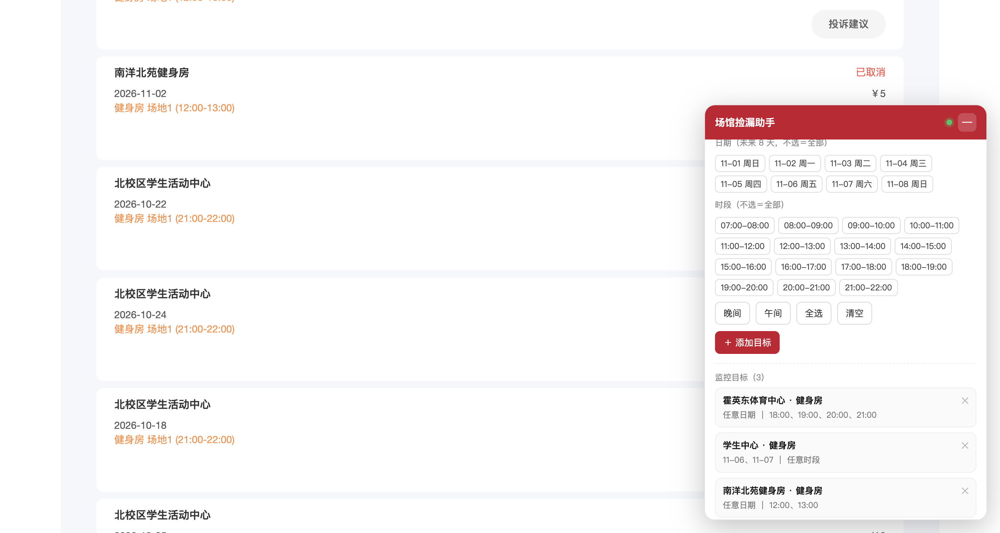

# SJTU 场馆捡漏助手

上海交通大学体育场馆（https://sports.sjtu.edu.cn/pc/）的空位监控 + 自动下单油猴脚本。

发现空位 → 先通知你 → 5 分钟内你自己没约 → 自动下单并提醒付款。也有「直接下单」模式。

---

## 一、为什么是油猴脚本

这张表决定了方案（都是实测结论）：

| 卡点 | 实测结果 | 影响 |
|---|---|---|
| 验证码 | 下单接口**没有**触发滑块（真单验证过两次） | 可以全自动 |
| 登录态 | 会话是 `JSESSIONID`，**HttpOnly + 会话级**，只在浏览器内存里，不落盘 | Python 后台进程拿不到，只能跑在浏览器里 |
| 付款 | 在 `cwc2.jdcw.sjtu.edu.cn` 独立系统，15 分钟内不付自动取消 | 付款必须你自己点，脚本只能提醒并帮你把页面打开 |
| 反爬 | 单次查询 ~25ms，连打 10 次无限流 | 轮询间隔可以设得很保守 |

所以：**脚本必须跑在你已登录的浏览器标签页里**，这就是油猴脚本的位置。

---

## 二、安装

1. Edge 打开 [Tampermonkey](https://microsoftedge.microsoft.com/addons/detail/tampermonkey/dhdgffkkebhmkfjojejmpbldmpobfkfo) 扩展页，安装。
2. 点扩展图标 → **管理面板** → 右上「＋」（添加新脚本）。
3. 打开 `sjtu-sport-monitor.user.js`，**全选复制**，粘贴进去覆盖编辑器里的模板，`Ctrl+S` 保存。
4. 打开 https://sports.sjtu.edu.cn/pc/ 并登录，右下角会出现红色 🎯 按钮。

> 更新脚本时重复第 2–3 步（覆盖粘贴）即可，配置不会丢。

---

## 三、使用

点 🎯 打开面板：

1. **添加目标**：选场馆 → 选项目（会自动加载，热门项目标「热门」）→ 选日期（不选＝未来 8 天全部）→ 选时段（不选＝全部）→ 点「＋ 添加目标」。
   可以加多个目标，比如「霍英东 健身房 任意日期 18:00–22:00」+「学生中心 健身房 周六 全天」。
2. **选模式**：
   - **先提醒**（默认）：检测到空位立刻弹通知 + 响铃，给你 N 分钟（默认 5）自己去约；时间到我会重新查，名额还在就直接下单。
   - **直接下单**：检测到就下单，抢得快，但你没得选。
3. **轮询间隔**：默认 90 秒，可调。**别低于 60 秒**，短间隔容易被判异常。
4. 点「开始监控」。想先验证配置对不对，点「试跑一次」。

**保持这个标签页开着**（可以最小化）。关掉浏览器或标签页，监控就停了。



---

## 四、它会做什么

```
每 N 秒（±15% 抖动）：
  对每个「场馆+项目」→ 查日期列表（拿 dateId，5 分钟缓存）
    对每个配置的日期 → 查格子表
      对每个配置的时段 → status==0 且 count>0 且还没开始
        ├─ 直接下单模式 → 立刻下单
        └─ 先提醒模式 → 通知 + 记下倒计时
             倒计时到 → 用最新数据复查 → 还在 → 下单
下单成功：
  取支付链接 → 自动打开付款页 → 通知「15 分钟内付款」
  5 分钟 / 10 分钟后再提醒一次
  所有目标都成功 → 自动停止
```

下单用的是站点自己的加密模块（从页面的 Vue 实例上取 `Aes`/`Rsa`），不是重写的实现，所以和网页点「提交订单」发出的请求完全一致。

---

## 五、手机上收通知（推荐）

电脑里的提醒是四层同时来：

1. **页面顶部全宽红色横幅** —— 会呼吸闪烁，点「知道了」才收，不可能看漏
2. **标签页标题闪烁**「🔴 发现空位…」—— 切到别的标签页也看得见
3. **提示音循环** —— 每 2.6 秒响一次，最长 3 分钟
4. 系统桌面通知（Edge 右上角）

但这些都要你人在电脑前。要推到手机上，在「通知」区填一个地址即可，脚本按地址自动识别服务：

| 手机 | 服务 | 地址怎么拿 |
|---|---|---|
| iPhone | **Bark**（首推） | App Store 装 Bark，打开后首页那串 `https://api.day.app/xxxxxxx` 直接复制 |
| Android | **ntfy** | 装 ntfy App → 订阅一个自己编的 topic（如 `sjtu-sport-9x7k`）→ 填 `https://ntfy.sh/你的topic` |
| 微信 | Server酱 | 打开 sct.ftqq.com 微信扫码登录 → 复制 `https://sctapi.ftqq.com/SCTxxxx.send` |
| 企业微信 | 群机器人 | 群设置 → 群机器人 → 添加 → 复制 webhook 地址 |

填完点 **「测试推送」**，手机会立刻收到一条测试消息；收不到就是地址填错或手机侧没订阅成功。

> 下单成功那条推送里会带上付款链接（Bark 上直接点开就能付款）。
> ⚠️ 手机推送只是把「有人在电脑前盯着」换成「电脑开着就行」——**电脑关机、休眠、断网、浏览器关掉，脚本就停了。**

---

## 六、已验证的行为

- ✅ 空位检测：真实账号，识别 `status=0` 且 `count>0`
- ✅ 自动下单：两次真实下单成功（订单 `1102786553446666240`、`1102794770130145280`），均已取消
- ✅ 支付链接：`orderImmediatelyPC` 能拿到 `cwc2` 支付地址
- ✅ 取消：`/tRefundReceipt/tRefundReceipt/createUserReceipt` 可用
- ✅ 无验证码

⚠️ 取消有个副作用：**如果已经调用过 `orderImmediatelyPC`（生成了支付单）再取消，订单会进入「退款受理中」**而不是直接「取消订单」。正常使用不会碰到（你会去付款），但测试时会看到这个状态。

---

## 七、风险与注意事项

- 学校《场馆使用须知》写明：**「严禁使用『外挂』或其他手段预约场地，一经发现，加入黑名单，取消预约场地权限。」** 这个脚本在服务端看来就是一组异常规律的请求 + 秒级下单。你把间隔设得太短、24 小时挂着跑，被识别的概率就高。自己权衡。
- 取消次数有限制：紧张/很紧张场地 7 天内最多取消 5 次，别拿脚本反复下单又取消。
- 爽约的代价更重：半年内第 2 次爽约禁约 1 个月，累积 3 次进黑名单。**下单了记得去。**
- 页面刷新后脚本会自动恢复上次的运行状态（3 秒后）。

---

## 八、已知限制

- 后台标签页的定时器会被浏览器节流（隐藏超过 5 分钟后最快 1 分钟一次），所以实际轮询可能比设定值慢一点。把标签页固定住即可。
- 如果服务端突然开始要滑块验证码，脚本会通知你「需要人工过验证码」并停手，不会硬刚。
- 只在 PC 版页面（`/pc/`）生效。

---

## 九、文件

| 文件 | 说明 |
|---|---|
| `sjtu-sport-monitor.user.js` | 脚本本体 |
| `docs/api-notes.md` | 逆向得到的接口/加密/状态码笔记 |
